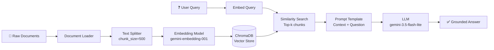

# 🧠 RAG — Retrieval-Augmented Generation with LangChain & ChromaDB

> A comprehensive, hands-on learning repository for building production-ready **RAG (Retrieval-Augmented Generation)** systems using LangChain, ChromaDB, Google Gemini embeddings, and multiple data source parsers.

---

## 📋 Table of Contents

- [Overview](#overview)
- [Project Structure](#project-structure)
- [Tech Stack](#tech-stack)
- [Modules](#modules)
  - [0 · Data Parsing](#0--data-parsing)
  - [1 · Vector Embeddings & Databases](#1--vector-embeddings--databases)
  - [2 · Vector Store with ChromaDB](#2--vector-store-with-chromadb)
- [RAG Architecture](#rag-architecture)
- [Getting Started](#getting-started)
- [Environment Variables](#environment-variables)
- [Requirements](#requirements)

---

## Overview

This project is a structured, notebook-driven exploration of **Retrieval-Augmented Generation (RAG)** — a technique that combines the power of large language models with external knowledge retrieval to produce accurate, grounded, and citation-able answers.

Rather than relying solely on an LLM's parametric knowledge (which can hallucinate or go stale), RAG:

1. **Stores** your documents as semantic vector embeddings in a vector database
2. **Retrieves** the most relevant chunks when a question is asked
3. **Augments** the LLM prompt with retrieved context to generate precise answers

---

## Project Structure

```
RAG/
├── 0-dataParsing/                  # Data ingestion from multiple sources
│   ├── 1-DataIngestion.ipynb       # Document structure & text splitters
│   ├── 2-DataParsingPDF.ipynb      # PDF parsing (PyMuPDF, PyPDF)
│   ├── 3-DataParsingDoc.ipynb      # Word document parsing
│   ├── 4-csvExcelParsing.ipynb     # CSV & Excel parsing
│   ├── 5-JsonParsing.ipynb         # JSON / JSONL parsing
│   ├── 6-DatabaseParsing.ipynb     # SQLite database parsing
│   └── data/                       # Sample data files
│       ├── pdf/                    # Sample PDFs (Attention paper)
│       ├── word_files/             # Sample .docx files
│       ├── text_files/             # Sample .txt files
│       ├── structured_files/       # CSV & Excel files
│       ├── json_files/             # JSON & JSONL files
│       └── databases/              # SQLite databases
│
├── 1-Vector EmbeddingAndDatabases/
│   └── embedding.ipynb             # Embedding fundamentals & similarity
│
├── 2-Vector store/
│   ├── 1-chromadb.ipynb            # Full RAG pipeline with ChromaDB
│   ├── data/                       # Sample text documents
│   └── chroma_db/                  # Persisted ChromaDB vector store
│
├── src/rag/                        # Package source
├── .env                            # API keys (not committed)
├── pyproject.toml                  # Project metadata & dependencies
├── requirements.txt                # Pip-installable dependencies
└── README.md
```

---

## Tech Stack

| Category | Technology |
|---|---|
| **Framework** | [LangChain](https://www.langchain.com/) |
| **Vector Database** | [ChromaDB](https://www.trychroma.com/) |
| **Embeddings** | Google `gemini-embedding-001` (3072-dim) |
| **LLM** | Google `gemini-3.5-flash-lite` via `langchain-google-genai` |
| **Data Parsers** | PyMuPDF, PyPDF, python-docx, pandas, openpyxl, jq |
| **Text Splitting** | `RecursiveCharacterTextSplitter`, `CharacterTextSplitter`, `TokenTextSplitter` |
| **Environment** | Python 3.14+, `uv` package manager |

---

## Modules

### 0 · Data Parsing

> **Path:** `0-dataParsing/`

Covers loading and structuring data from every common format into LangChain `Document` objects — the universal unit of content in the pipeline.

| Notebook | What it covers |
|---|---|
| `1-DataIngestion.ipynb` | Document structure, `RecursiveCharacterTextSplitter`, `CharacterTextSplitter`, `TokenTextSplitter` |
| `2-DataParsingPDF.ipynb` | Parsing PDFs using `PyMuPDF` and `PyPDF` loaders |
| `3-DataParsingDoc.ipynb` | Parsing Word `.docx` files using `python-docx` and `docx2txt` |
| `4-csvExcelParsing.ipynb` | Reading tabular data from CSV and Excel using `pandas` and `openpyxl` |
| `5-JsonParsing.ipynb` | Parsing JSON and JSONL files with `jq` expressions |
| `6-DatabaseParsing.ipynb` | Querying SQLite databases and converting results to Documents |

---

### 1 · Vector Embeddings & Databases

> **Path:** `1-Vector EmbeddingAndDatabases/embedding.ipynb`

A visual and conceptual deep-dive into **what embeddings are** and **how similarity works**.

- 2D embedding visualization with `matplotlib`
- Cosine similarity vs. Euclidean (L2) distance
- Understanding high-dimensional vector spaces
- Foundation for all downstream vector store work

---

### 2 · Vector Store with ChromaDB

> **Path:** `2-Vector store/1-chromadb.ipynb`

The centrepiece of the project — a **complete, end-to-end RAG pipeline**:

| Step | Implementation |
|---|---|
| **Document Loading** | `DirectoryLoader` + `TextLoader` from a local `data/` folder |
| **Text Splitting** | `RecursiveCharacterTextSplitter` — 500-char chunks, 50-char overlap |
| **Embedding Generation** | `GoogleGenerativeAIEmbeddings(model="gemini-embedding-001")` → 3072-dim vectors |
| **Vector Store Creation** | `Chroma.from_documents()` persisted to `./chroma_db` |
| **Similarity Search** | `vectorstore.similarity_search(query, k=3)` |
| **Search with Scores** | `vectorstore.similarity_search_with_score()` — L2 distance metric |
| **Retriever** | `vectorstore.as_retriever()` for use in chains |
| **RAG Chain (Standard)** | `create_stuff_documents_chain` + `create_retrieval_chain` |
| **RAG Chain (LCEL)** | LangChain Expression Language: `retriever \| format_docs \| prompt \| llm \| StrOutputParser` |
| **Incremental Updates** | `vectorstore.add_documents()` — add new documents without rebuilding |

**Similarity Score Reference (ChromaDB default — L2 distance):**

| Score | Meaning |
|---|---|
| `0` | Identical vectors |
| `< 0.5` | Highly similar |
| `0.5 – 1.0` | Moderately similar |
| `> 1.0` | Likely unrelated |

---

## RAG Architecture



---

## Getting Started

### 1. Clone the repository

```bash
git clone <your-repo-url>
cd RAG
```

### 2. Set up the environment

Using `uv` (recommended):

```bash
uv sync
```

Or using pip:

```bash
python -m venv .venv
source .venv/bin/activate   # Windows: .venv\Scripts\activate
pip install -r requirements.txt
```

### 3. Configure your API key

Create a `.env` file in the project root:

```env
GEMINI_API_KEY=your_google_gemini_api_key_here
```

> Get your Gemini API key from [Google AI Studio](https://aistudio.google.com/).

### 4. Run the notebooks

Open the notebooks in order using VS Code (with the Jupyter extension) or JupyterLab:

```
0-dataParsing/      → Start here for data loading fundamentals
1-Vector EmbeddingAndDatabases/ → Understand embeddings visually
2-Vector store/     → Build the full RAG pipeline
```

---

## Environment Variables

| Variable | Description | Required |
|---|---|---|
| `GEMINI_API_KEY` | Google Gemini API key for embeddings and LLM | ✅ Yes |

---

## Requirements

Key dependencies (see [`pyproject.toml`](./pyproject.toml) for full list):

```
langchain >= 1.4.3
langchain-community >= 0.4.2
langchain-google-genai >= 4.4.2
langchain-text-splitters >= 1.1.3
chromadb >= 1.5.9
sentence-transformers >= 6.1.0
faiss-cpu >= 1.15.1
pymupdf >= 1.28.2
pypdf >= 6.19.0
python-docx >= 1.2.0
pandas >= 3.0.6
openpyxl >= 3.1.5
python-dotenv >= 1.2.4
```

---

## Author

**Kamakhya-s** — [kamakhyaparihar14@gmail.com](mailto:kamakhyaparihar14@gmail.com)

---

<div align="center">
  <sub>Built with ❤️ using LangChain · ChromaDB · Google Gemini</sub>
</div>
